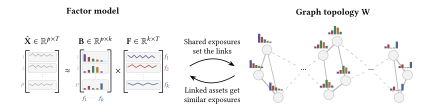

# MINGLE: Mutually-Informed Graph-Locality and Exposures

<p align="center">
  <a href="https://doi.org/10.1145/3858063.3858790"></a>
  <a href="assets/ICAIF26_mingle_poster.pdf"></a>
  <a href="LICENSE"></a>
</p>

MINGLE jointly learns a factor model and a graph of assets, linking assets that share the same risk exposures rather than those that happened to move together. The resulting graph recovers economic sectors without supervision, is far better conditioned than the sample covariance, and improves portfolio diversification across market regimes.

**Code for the paper**
> **Beyond Co-Movement: Locality by Exposures Enables a Joint Factor–Graph Framework for Portfolio Diversification**\
> Sara Chehab\*, Giorgos Iacovides\*, Parisa Yazdanparast, Danilo Mandic (\*equal contribution)\
> *7th ACM International Conference on AI in Finance (ICAIF'26)*, Milan, November 2026.


## Overview of the joint graph–factor framework

Diversification depends on knowing how assets relate. Correlations are the usual proxy, but estimated from limited data they are dominated by noise. Two remedies exist, each capturing half the picture:
- **Factor models** describe *what drives returns* with few parameters, but ignore how assets relate to each other.
- **Graphs** describe *how assets relate*, which suits diversification, but are widely ill-defined when built from correlations.

We reconcile these two views by having the factor model define the exposures on which graph locality is measured, and the graph smooth those exposures over neighbourhoods.

<p align="center">
  
</p>

For a universe of $p$ assets with historical returns
$\mathbf{X} \in \mathbb{R}^{p \times T}$, factor exposures
$\mathbf{B} \in \mathbb{R}^{p \times k}$, factor dynamics
$\mathbf{F} \in \mathbb{R}^{k \times T}$, and graph topology
$\mathbf{W} \in \mathbb{R}^{p \times p}$, the optimisation problem can be formalised as

```math
\begin{aligned}
\min_{\mathbf{B},\mathbf{F},\mathbf{W}} \quad
& \underbrace{
\left\lVert \mathbf{X}-\mathbf{B}\mathbf{F}\right\rVert_{\boldsymbol{\Omega}}^2
}_{\text{Factor decomposition}}
\\
& + \underbrace{
\lambda \sum_{i=1}^{p}\sum_{j=1}^{p}
w_{ij}\left\lVert\mathbf{b}_i-\mathbf{b}_j\right\rVert_2^2
}_{\text{Exposure smoothness on graph}}
\\
& + \underbrace{
\alpha\left\lVert\mathbf{W}\right\rVert_1
}_{\text{Graph sparsity}}
-
\underbrace{
\beta\,\mathbf{1}^{\top}
\log\left(\mathbf{W}\mathbf{1}+\varepsilon\mathbf{1}\right)
}_{\text{Degree barrier}}
\\
& + \underbrace{
\delta
\left\lVert
\mathrm{offdiag}
\left(\mathbf{F}\boldsymbol{\Omega}\mathbf{F}^{\top}\right)
\right\rVert_F^2
}_{\text{Factor decorrelation}}
\\[0.5em]
\text{s.t.}\quad
& \mathbf{B}^{\top}\mathbf{B}=\mathbf{I},
\\
& w_{ij}\geq 0\quad\forall i,j,
\qquad
w_{ii}=0\quad\forall i,
\qquad
\mathbf{W}^{\top}=\mathbf{W}.
\end{aligned}
```

This objective is subsequently solved through the ADMM iterations implemented in [mingle/utils/admm/joint.py](mingle/utils/admm/joint.py).

On 300 equities over January 2019 to March 2026, Contagion Cut on the learnt graph reaches a Sharpe ratio of 1.07, against 0.86 for the same allocator on the sample covariance.

## Installation

```bash
git clone https://github.com/sarachehab/mingle-icaif26.git
cd mingle-icaif26
python -m venv .venv && source .venv/bin/activate
pip install -e .
```


## Quick start

The input, `X`, is a NumPy array of log-returns of shape `(n_assets, T)`, with one row per asset.

```python
import numpy as np
import mingle.configs.defaults as d
from mingle.utils.allocation import CutAllocation, ContagionCut
from mingle.utils.allocation.cut import get_cut_alg
from mingle.utils.rebalancing.algorithms.admm import AdmmRebalancingWrapper

X = ...  # (n_assets, T) log-returns, e.g. np.log(prices).diff().dropna().to_numpy().T

model = AdmmRebalancingWrapper(
    nb_factors=d.NB_FACTORS,
    alpha=d.ALPHA, beta=d.BETA, lambda_l=d.LAMBDA_L, eps=d.EPS, delta=d.DELTA,
    max_epochs=d.MAX_EPOCHS, abs_eps=d.ABS_EPS, rel_eps=d.REL_EPS,
    abs_eps_B=d.ABS_EPS_B, rel_eps_B=d.REL_EPS_B,
    rho_B=d.RHO_B, rho_W=d.RHO_W, rho_d=d.RHO_D,
    adapt_every=d.ADAPT_EVERY, mu=d.MU, tau=d.TAU, rho_min=d.RHO_MIN, rho_max=d.RHO_MAX,
    decay=d.DECAY,
    allocation=ContagionCut(get_cut_alg(d.CUT_TYPE, d.CUT_V_COUNT)),  # or CutAllocation(...)
)

weights, fit = model.get_weights(X)
# weights : (n_assets,) long-only portfolio weights, summing to 1
# fit.B   : (n_assets, k) learnt factor exposures
# fit.F   : (k, T) learnt factor dynamics
# fit.W   : (n_assets, n_assets) learnt exposure-similarity graph
# fit.terminates : whether the ADMM converged within max_epochs
```

For the rolling scheme described in the paper, use `PortfolioRebalancing`:

```python
from mingle.utils.rebalancing import PortfolioRebalancing, RebalancingFrequency

prices = ...  # pd.DataFrame of prices, indexed by date, with one column per asset

rebalancing = PortfolioRebalancing(
    freq=RebalancingFrequency.MONTHLY,
    window_months=d.LOOKBACK_HORIZON,  # two-year lookback window
)

in_sample, out_of_sample, weights, fits = rebalancing.run(prices, model)
# out_of_sample : pd.Series of daily out-of-sample portfolio returns
# in_sample     : pd.Series of daily in-sample portfolio returns
# weights       : pd.DataFrame of portfolio weights, one row per rebalancing
# fits          : list of per-window fits, each with B, F, W and train/test dates

cumulative_returns = (1 + out_of_sample).cumprod()
```

## Reproducing the paper

The universe is 300 equities: the 100 most actively traded constituents of each of the **S&P 500**, **Nikkei 225** and **STOXX 600**, with daily USD close prices from 2017-01-04 to 2026-03-30, re-estimated monthly on a two-year lookback (held-out period: January 2019 to March 2026).

> [!IMPORTANT]
> **The equity prices were extracted from the Bloomberg Terminal and cannot be redistributed.** With Bloomberg Terminal access, [data/bloomberg_extractor.ipynb](data/bloomberg_extractor.ipynb) extracts them in the format expected by the loader. Otherwise, any other data source may be used, as described in [Using your own data](docs/experiments.md#using-your-own-data). The risk-free rate and VIX series are publicly available.

```bash
run-experiment -c experiments/ref.yaml     # 300 assets: Table 2, Figures 2, 4, 5 and 6
run-experiment -c experiments/sp500.yaml   # S&P 500 only: Figure 3
```

Then run [visualisations.ipynb](visualisations.ipynb) to produce the tables and figures; see [docs/experiments.md](docs/experiments.md) for the full mapping, custom data and the config format.


## License

The code is released under the [MIT License](LICENSE). The paper is published under [CC BY 4.0](https://creativecommons.org/licenses/by/4.0/).

## Citation

If you find this work useful, please consider starring the repository and citing:

```bibtex
@inproceedings{chehab2026mingle,
  author    = {Chehab, Sara and Iacovides, Giorgos and Yazdanparast, Parisa and Mandic, Danilo},
  title     = {Beyond Co-Movement: Locality by Exposures Enables a Joint Factor--Graph Framework for Portfolio Diversification},
  booktitle = {Proceedings of the 7th ACM International Conference on AI in Finance},
  series    = {ICAIF '26},
  year      = {2026},
  month     = nov,
  numpages  = {9},
  location  = {Milan, Italy},
  publisher = {Association for Computing Machinery},
  address   = {New York, NY, USA},
  isbn      = {979-8-4007-3087-0},
  doi       = {10.1145/3858063.3858790},
}
```

## Contact

For any questions, please contact Sara Chehab at [sara.chehab22@imperial.ac.uk](mailto:sara.chehab22@imperial.ac.uk).
